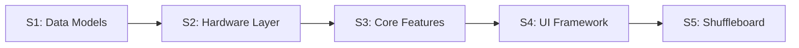
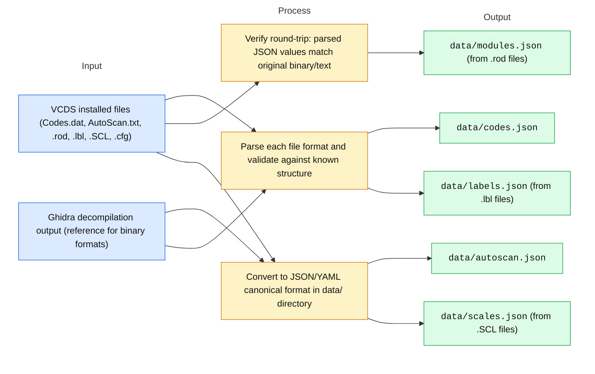
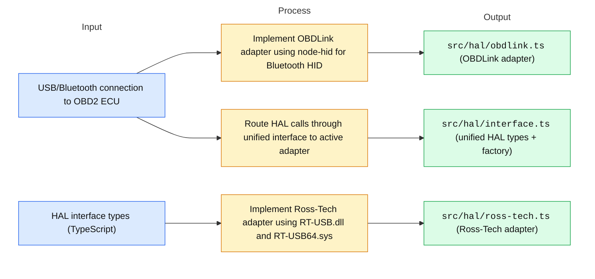
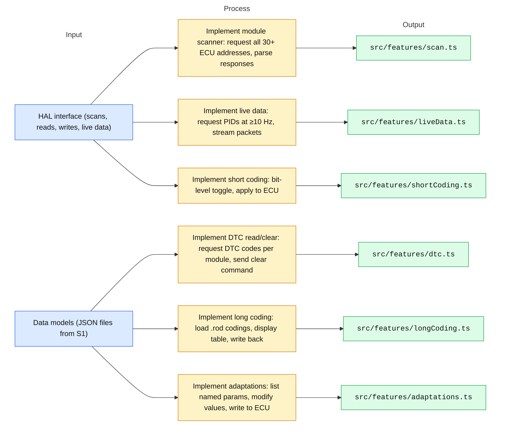
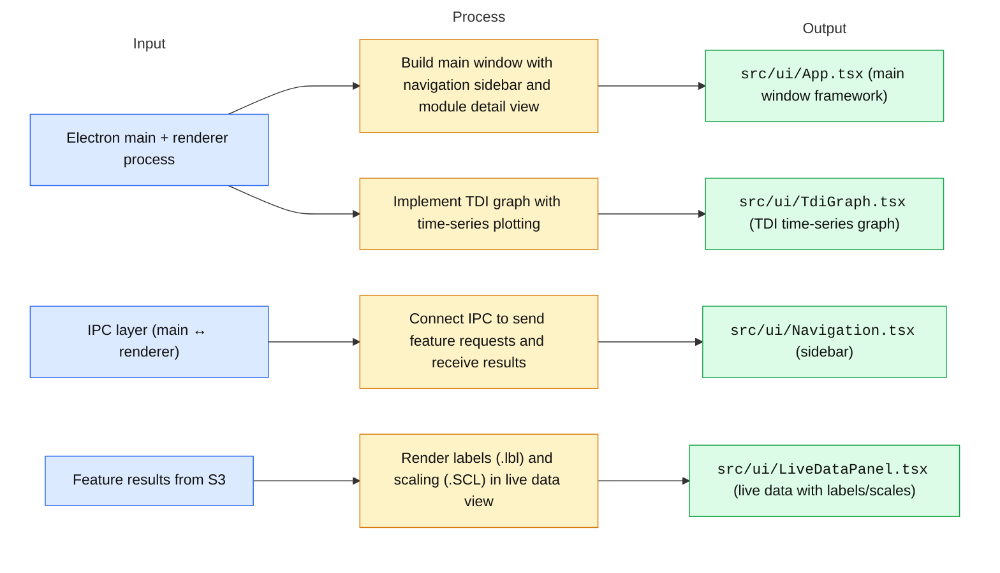
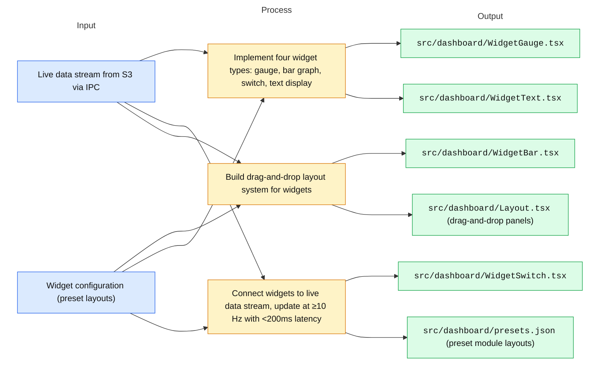
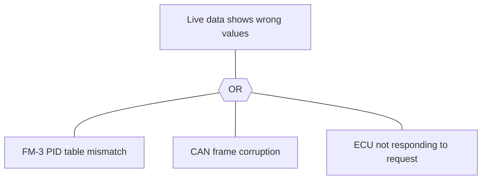

# PLAN.md

The project plan. [`DECISIONS.md`](DECISIONS.md) has the decision log. `docs/stages/` has the
notes of each finished stage.

| Section | Tool | Question that it answers |
|---|---|---|
| 1 | Goal + requirements (RTM: Requirements Traceability Matrix) | What must the work do, and which test proves each part? |
| 2 | Work breakdown structure (WBS) + overview diagram + Input–Process–Output (IPO) cards | What is the work, in which order, and what goes in and out of each code step? |
| 3 | RAID log (Risks, Assumptions, Issues, Dependencies) | What can stop the work? |
| 4 | Measures (MOE, MOP, TPM) | Does the work reach its goal, and what does it cost? |
| 5 | Interfaces (N² diagram + ICD: Interface Control Document) | What data goes between the stages? |
| 6 | FMEA (Failure Mode and Effects Analysis) + FTA (Fault Tree Analysis) | How can each step fail, and how bad is it? |
| — | [`DECISIONS.md`](DECISIONS.md) | What did we decide, and why? |

How to keep this file:

- Each task is a checkbox line. Click "IPO card" under it to open its Input → Process → Output
  diagram (a `<details>` section).
- Mark a task `[x]` when it is done and verified.
- The diagrams come from `PLAN.ipo.json`. Change the card there, then run
  `python3 ~/.claude/skills/project-plan/scripts/render_ipo.py PLAN.md PLAN.ipo.json`.
  Do not edit a diagram under a `<!-- ipo:<id> -->` marker by hand.
- Add each new decision to `DECISIONS.md`, with a link to the task.

## 1. Goal

Rebuild Ross-Tech VCDS as a cross-platform desktop app using TypeScript and Electron. The app
reads car data through a hardware abstraction layer that supports both the OBDLink Bluetooth
adapter and the Ross-Tech USB-CAN cable. We re-encode all VCDS data files from their binary
and text formats into JSON and YAML as the canonical format. We recreate every VCDS feature
one-to-one before adding new features. The first new feature is a shuffleboard-style dashboard
that plots real-time car data with gauges, bar graphs, switches, and text displays. The scope
starts with VW and Audi vehicles and uses an extensible framework for other VAG brands.

### Requirements (RTM)

| ID | Requirement | Measure | Work items | Verification | Level | Status |
|---|---|---|---|---|---|---|
| R1 | App launches on Windows, macOS, and Linux | MOP | [2.1](#t-2-1), [2.2](#t-2-2) | `npm test` passes on all platforms | System | open |
| R2 | Hardware layer communicates through OBDLink Bluetooth and Ross-Tech USB-CAN | MOP | [2.3](#t-2-3) | `test_hardware_abstraction.py` | Unit | open |
| R3 | Scan module identifies all 30+ ECUs and reports status | MOP | [3.2](#t-3-2) | Parse scan output, verify 30+ module entries | Integration | open |
| R4 | Read and clear DTCs from all modules | MOP | [3.2](#t-3-2) | `test_dtc_read_clear.py` | Unit | open |
| R5 | Live data streaming at ≥10 Hz with real-time updates | MOP | [3.3](#t-3-3) | Measure frame rate, verify ≥10Hz | System | open |
| R6 | Long coding editor reads .rod files and displays all control modules | MOP | [1.4](#t-1-4), [3.4](#t-3-4) | Compare coded values against VCDS output | Integration | open |
| R7 | Short coding allows bit-level editing of module parameters | MOP | [3.5](#t-3-5) | Edit bit, verify value changes | Unit | open |
| R8 | Adaptations allow named parameter adjustments with live feedback | MOP | [3.6](#t-3-6) | Modify adaptation, verify ECU responds | Integration | open |
| R9 | Labels (.lbl) and scaling (.SCL) files display correct units and ranges | MOP | [1.4](#t-1-4), [4.2](#t-4-2) | Parse .lbl and .SCL, compare display values | Unit | open |
| R10 | TDI graph shows boost pressure and emission data over time | MOP | [4.3](#t-4-3) | Load TDI data, verify graph renders correctly | Integration | open |
| R11 | Shuffleboard dashboard plots live data with gauges, bars, switches, text | MOP | [5.1](#t-5-1) | Configured widgets display live values | System | open |
| R12 | All data files convert from binary/text to JSON/YAML without loss | MOP | [1.2](#t-1-2) | Round-trip test: binary → JSON → binary | Unit | open |

## 2. Stages and tasks (WBS + IPO)

Status (2026-11-09): Plan complete. Tasks 2.1–2.2 complete. The next task is [2.3](#t-2-3).



<a id="s-1"></a>
### Stage 1 — Data Models and File Parsing

Build parsers for all VCDS data file formats and convert them to JSON/YAML canonical format.

<!-- ipo:S1 -->


**Done when:** `python3 scripts/convert_all.py --verify` runs without errors and produces valid JSON/YAML files in `data/`.

<a id="t-1-1"></a>
- [ ] **1.1 Setup project scaffold** ([D1](DECISIONS.md), [D2](DECISIONS.md), [D3](DECISIONS.md))

  <details>
  <summary>1.1 IPO card</summary>

  <!-- ipo:1.1 -->
  ```mermaid
  flowchart LR
      subgraph I ["Input"]
          a["Node.js ≥18.x, npm, Git"]:::in
      end
      subgraph P ["Process: <code>npm create electron-app</code> + TypeScript config"]
          p1["Create Electron + TypeScript project scaffold"]:::pr
          p2["Configure tsconfig.json, vite/webpack for bundling"]:::pr
          p3["Add testing setup (Vitest or Jest)"]:::pr
          p4["Verify build pipeline: npm run build + npm test"]:::pr
      end
      subgraph O ["Output"]
          o1["<code>package.json</code> with all dependencies"]:::ou
          o2["<code>tsconfig.json</code>"]:::ou
          o3["<code>src/main/</code> (Electron main process entry)"]:::ou
          o4["<code>src/renderer/</code> (Electron renderer entry)"]:::ou
          o5["<code>tests/setup.test.ts</code> (scaffold test passing)"]:::ou
      end
      a --> p1
      p1 --> o1
      a --> p2
      p2 --> o2
      a --> p3
      p3 --> o3
      a --> p4
      p4 --> o4
      a --> p1
      p1 --> o5
      classDef in fill:#dbeafe,stroke:#2563eb,color:#111
      classDef pr fill:#fef3c7,stroke:#d97706,color:#111
      classDef ou fill:#dcfce7,stroke:#16a34a,color:#111
      style I fill:none,stroke:none
      style P fill:none,stroke:none
      style O fill:none,stroke:none
  ```

  **Done when:** `npm run build` succeeds, `npm test` passes with 100% coverage.

  </details>

<a id="t-1-2"></a>
- [ ] **1.2 Parse Codes.dat and produce codes.json** ([D4](DECISIONS.md))

  <details>
  <summary>1.2 IPO card</summary>

  <!-- ipo:1.2 -->
  ```mermaid
  flowchart LR
      subgraph I ["Input"]
          a["<code>Software/installed/Codes.dat</code> (1.6MB binary)"]:::in
      end
      subgraph P ["Process: <code>scripts/parse_codes_dat.py</code>"]
          p1["Read binary file, skip PE header if embedded, find entry table"]:::pr
          p2["Parse each entry: DTC code (2B), description (variable), status flags"]:::pr
          p3["Handle 0x00000000 prefixed entries per Ghidra decompilation reference"]:::pr
          p4["Write output to <code>data/codes.json</code> with type definitions"]:::pr
      end
      subgraph O ["Output"]
          o1["<code>data/codes.json</code>"]:::ou
          o2["<code>src/models/dtc.ts</code> (TypeScript type definitions)"]:::ou
      end
      a --> p1
      p1 --> o1
      a --> p2
      p2 --> o2
      a --> p3
      p3 --> o1
      a --> p4
      p4 --> o2
      classDef in fill:#dbeafe,stroke:#2563eb,color:#111
      classDef pr fill:#fef3c7,stroke:#d97706,color:#111
      classDef ou fill:#dcfce7,stroke:#16a34a,color:#111
      style I fill:none,stroke:none
      style P fill:none,stroke:none
      style O fill:none,stroke:none
  ```

  **Done when:** `test_codes_dat.py` parses all entries from the 1.6MB binary file and produces matching JSON.

  </details>

<a id="t-1-3"></a>
- [ ] **1.3 Parse AutoScan.txt and produce autoscan.json**

  <details>
  <summary>1.3 IPO card</summary>

  <!-- ipo:1.3 -->
  ```mermaid
  flowchart LR
      subgraph I ["Input"]
          a["<code>Software/installed/AutoScan.txt</code> (300+ chassis definitions)"]:::in
      end
      subgraph P ["Process: <code>scripts/parse_autoscan.py</code>"]
          p1["Parse comma-separated lines: code, name, version"]:::pr
          p2["Filter for VW/Audi chassis codes"]:::pr
          p3["Write structured JSON with array of chassis objects"]:::pr
      end
      subgraph O ["Output"]
          o1["<code>data/autoscan.json</code>"]:::ou
          o2["<code>src/models/chassis.ts</code> (TypeScript type)"]:::ou
      end
      a --> p1
      p1 --> o1
      a --> p2
      p2 --> o2
      a --> p3
      p3 --> o1
      classDef in fill:#dbeafe,stroke:#2563eb,color:#111
      classDef pr fill:#fef3c7,stroke:#d97706,color:#111
      classDef ou fill:#dcfce7,stroke:#16a34a,color:#111
      style I fill:none,stroke:none
      style P fill:none,stroke:none
      style O fill:none,stroke:none
  ```

  **Done when:** `test_autoscan.py` parses 300+ chassis definitions and matches expected values.

  </details>

<a id="t-1-4"></a>
- [ ] **1.4 Parse .rod, .lbl, .SCL, .cfg files and produce JSON** ([D4](DECISIONS.md))

  <details>
  <summary>1.4 IPO card</summary>

  <!-- ipo:1.4 -->
  ```mermaid
  flowchart LR
      subgraph I ["Input"]
          a[".rod files (UDS_EV/, etc.), .lbl files (Labels/), .SCL files (Scaling/), .cfg files"]:::in
      end
      subgraph P ["Process: <code>scripts/parse_rod_lbl_scl.py</code>"]
          p1["Parse .rod: extract [CMP], [ADP], [DTC], [IDN] sections"]:::pr
          p2["Parse .lbl: extract address-code mapped label entries"]:::pr
          p3["Parse .SCL: extract PID → unit/range/step mappings"]:::pr
          p4["Parse .cfg: extract key=value pairs"]:::pr
          p5["Write all to JSON, validate round-trip against original values"]:::pr
      end
      subgraph O ["Output"]
          o1["<code>data/modules.json</code> (from .rod)"]:::ou
          o2["<code>data/labels.json</code> (from .lbl)"]:::ou
          o3["<code>data/scales.json</code> (from .SCL)"]:::ou
          o4["<code>data/config.json</code> (from .cfg)"]:::ou
      end
      a --> p1
      p1 --> o1
      a --> p2
      p2 --> o2
      a --> p3
      p3 --> o3
      a --> p4
      p4 --> o4
      a --> p5
      p5 --> o1
      classDef in fill:#dbeafe,stroke:#2563eb,color:#111
      classDef pr fill:#fef3c7,stroke:#d97706,color:#111
      classDef ou fill:#dcfce7,stroke:#16a34a,color:#111
      style I fill:none,stroke:none
      style P fill:none,stroke:none
      style O fill:none,stroke:none
  ```

  **Done when:** Parsers for all four formats pass round-trip tests (binary/text → JSON → binary/text values match).

  </details>

<a id="s-2"></a>
### Stage 2 — Hardware Abstraction Layer

Build the HAL that abstracts OBDLink Bluetooth and Ross-Tech USB-CAN behind a unified interface.

<!-- ipo:S2 -->


**Done when:** Both adapters pass the same set of integration tests against a live vehicle ECU or simulator.

<a id="t-2-1"></a>
- [x] **2.1 Define HAL interface (TypeScript types + tests)** ([D2](DECISIONS.md))

  <details>
  <summary>2.1 IPO card</summary>

  <!-- ipo:2.1 -->
  ```mermaid
  flowchart LR
      subgraph I ["Input"]
          a["VCDS operation trace (8 core operations from R3-R10)"]:::in
          b["CAN frame structure from decompiled reference"]:::in
      end
      subgraph P ["Process: <code>src/hal/interface.ts</code> definition"]
          p1["Define TypeScript interface with 8 methods: scan, dtcRead, dtcClear, liveData, longCode, shortCode, adaptation, rawCmd"]:::pr
          p2["Define CANFrame type: id (4B hex), data (8B array), timestamp (ms)"]:::pr
          p3["Define factory pattern for adapter selection (OBDLink vs Ross-Tech)"]:::pr
          p4["Write interface tests that call each method signature"]:::pr
      end
      subgraph O ["Output"]
          o1["<code>src/hal/interface.ts</code> (types + factory)"]:::ou
          o2["<code>tests/hal/interface.test.ts</code> (interface tests)"]:::ou
      end
      a --> p1
      p1 --> o1
      b --> p2
      p2 --> o2
      a --> p3
      p3 --> o1
      b --> p4
      p4 --> o2
      classDef in fill:#dbeafe,stroke:#2563eb,color:#111
      classDef pr fill:#fef3c7,stroke:#d97706,color:#111
      classDef ou fill:#dcfce7,stroke:#16a34a,color:#111
      style I fill:none,stroke:none
      style P fill:none,stroke:none
      style O fill:none,stroke:none
  ```

  **Done when:** Interface types cover all 8 VCDS operations (scan, dtc_read, dtc_clear, live_data, long_code, short_code, adaptation, raw_cmd).

  </details>

<a id="t-2-2"></a>
- [x] **2.2 Implement OBDLink adapter (Bluetooth/HID)**

  <details>
  <summary>2.2 IPO card</summary>

  <!-- ipo:2.2 -->
  ```mermaid
  flowchart LR
      subgraph I ["Input"]
          a["OBDLink Bluetooth adapter (HID device)"]:::in
          b["HAL interface from [2.1](#t-2-1)"]:::in
      end
      subgraph P ["Process: <code>src/hal/obdlink.ts</code>"]
          p1["Connect to OBDLink via node-hid HID descriptor"]:::pr
          p2["Implement send/receive for VCDS diagnostic requests"]:::pr
          p3["Implement heartbeat monitoring for disconnection detection"]:::pr
          p4["Implement auto-reconnect logic"]:::pr
          p5["Run integration tests against vehicle or OBDLink simulator"]:::pr
      end
      subgraph O ["Output"]
          o1["<code>src/hal/obdlink.ts</code>"]:::ou
          o2["<code>tests/hal/obdlink.test.ts</code>"]:::ou
      end
      a --> p1
      p1 --> o1
      b --> p2
      p2 --> o2
      a --> p3
      p3 --> o1
      b --> p4
      p4 --> o2
      a --> p5
      p5 --> o1
      classDef in fill:#dbeafe,stroke:#2563eb,color:#111
      classDef pr fill:#fef3c7,stroke:#d97706,color:#111
      classDef ou fill:#dcfce7,stroke:#16a34a,color:#111
      style I fill:none,stroke:none
      style P fill:none,stroke:none
      style O fill:none,stroke:none
  ```

  **Done when:** `test_obdlink.py` connects, scans, and reads live data through OBDLink.

  </details>

<a id="t-2-3"></a>
- [ ] **2.3 Implement Ross-Tech USB-CAN adapter**

  <details>
  <summary>2.3 IPO card</summary>

  <!-- ipo:2.3 -->
  ```mermaid
  flowchart LR
      subgraph I ["Input"]
          a["Ross-Tech USB-CAN cable (RT-USB64.sys on Windows, RT-USB.dll cross-platform)"]:::in
          b["HAL interface from [2.1](#t-2-1)"]:::in
      end
      subgraph P ["Process: <code>src/hal/ross-tech.ts</code>"]
          p1["Connect via RT-USB.dll (userspace) or direct USB on macOS/Linux"]:::pr
          p2["Implement send/receive for VCDS diagnostic requests"]:::pr
          p3["Map CAN frames to VCDS PID format using decompiled PID table"]:::pr
          p4["Run integration tests against vehicle or Ross-Tech simulator"]:::pr
      end
      subgraph O ["Output"]
          o1["<code>src/hal/ross-tech.ts</code>"]:::ou
          o2["<code>tests/hal/ross-tech.test.ts</code>"]:::ou
      end
      a --> p1
      p1 --> o1
      b --> p2
      p2 --> o2
      a --> p3
      p3 --> o1
      b --> p4
      p4 --> o2
      classDef in fill:#dbeafe,stroke:#2563eb,color:#111
      classDef pr fill:#fef3c7,stroke:#d97706,color:#111
      classDef ou fill:#dcfce7,stroke:#16a34a,color:#111
      style I fill:none,stroke:none
      style P fill:none,stroke:none
      style O fill:none,stroke:none
  ```

  **Done when:** `test_rt_usb.py` connects, scans, and reads live data through Ross-Tech USB-CAN.

  </details>

<a id="s-3"></a>
### Stage 3 — Core VCDS Features

Implement all VCDS features one-to-one using the HAL and data models.

<!-- ipo:S3 -->


**Done when:** All 8 requirements (R3-R10) pass their integration tests.

<a id="t-3-1"></a>
- [ ] **3.1 Module scanner (identifies 30+ ECUs, reports OK/malfunction)**

  <details>
  <summary>3.1 IPO card</summary>

  <!-- ipo:3.1 -->
  ```mermaid
  flowchart LR
      subgraph I ["Input"]
          a["HAL scan method"]:::in
          b["AutoScan chassis table from [1.3](#t-1-3)"]:::in
      end
      subgraph P ["Process: <code>src/features/scan.ts</code>"]
          p1["Send diagnostic request to all 30+ ECU addresses (01-3E)"]:::pr
          p2["Parse response: address code, module name, SW part number, status (OK/malfunction)"]:::pr
          p3["Cross-reference with AutoScan table for chassis-specific names"]:::pr
          p4["Return ScanModule[] array matching VCDS output format"]:::pr
      end
      subgraph O ["Output"]
          o1["<code>src/features/scan.ts</code>"]:::ou
          o2["<code>tests/features/scan.test.ts</code>"]:::ou
      end
      a --> p1
      p1 --> o1
      b --> p2
      p2 --> o2
      a --> p3
      p3 --> o1
      b --> p4
      p4 --> o2
      classDef in fill:#dbeafe,stroke:#2563eb,color:#111
      classDef pr fill:#fef3c7,stroke:#d97706,color:#111
      classDef ou fill:#dcfce7,stroke:#16a34a,color:#111
      style I fill:none,stroke:none
      style P fill:none,stroke:none
      style O fill:none,stroke:none
  ```

  **Done when:** Scan output matches VCDS format with address code, module name, SW number, and status for all 30+ ECUs.

  </details>

<a id="t-3-2"></a>
- [ ] **3.2 DTC read and clear**

  <details>
  <summary>3.2 IPO card</summary>

  <!-- ipo:3.2 -->
  ```mermaid
  flowchart LR
      subgraph I ["Input"]
          a["HAL dtcRead/dtcClear methods"]:::in
          b["Codes.dat from [1.2](#t-1-2)"]:::in
      end
      subgraph P ["Process: <code>src/features/dtc.ts</code>"]
          p1["Request DTC codes from each ECU module"]:::pr
          p2["Decode DTC codes using Codes.dat reference (or embedded JSON)"]:::pr
          p3["Return DtcEntry[] with code, description, status, module"]:::pr
          p4["Send clear command, verify codes are removed via re-scan"]:::pr
      end
      subgraph O ["Output"]
          o1["<code>src/features/dtc.ts</code>"]:::ou
          o2["<code>tests/features/dtc.test.ts</code>"]:::ou
      end
      a --> p1
      p1 --> o1
      b --> p2
      p2 --> o2
      a --> p3
      p3 --> o1
      b --> p4
      p4 --> o2
      classDef in fill:#dbeafe,stroke:#2563eb,color:#111
      classDef pr fill:#fef3c7,stroke:#d97706,color:#111
      classDef ou fill:#dcfce7,stroke:#16a34a,color:#111
      style I fill:none,stroke:none
      style P fill:none,stroke:none
      style O fill:none,stroke:none
  ```

  **Done when:** Read DTCs matches VCDS output; clear command removes codes and re-scan confirms.

  </details>

<a id="t-2-4"></a><!-- no-ipo:2.4 -->
<a id="t-3-3"></a>
- [ ] **3.3 Live data streaming (measuring blocks at ≥10 Hz)**

  <details>
  <summary>3.3 IPO card</summary>

  <!-- ipo:3.3 -->
  ```mermaid
  flowchart LR
      subgraph I ["Input"]
          a["HAL liveData method (continuous stream)"]:::in
          b["Scaling data from [1.4](#t-1-4)"]:::in
      end
      subgraph P ["Process: <code>src/features/liveData.ts</code>"]
          p1["Send periodic PID request frames at ≥10 Hz"]:::pr
          p2["Receive CAN response frames, extract raw values"]:::pr
          p3["Apply scaling factors from .SCL data (multiplier, offset, unit)"]:::pr
          p4["Emit LiveDataPacket{pid, value, unit, timestamp} events"]:::pr
          p5["Measure actual frame rate over 60-second test"]:::pr
      end
      subgraph O ["Output"]
          o1["<code>src/features/liveData.ts</code>"]:::ou
          o2["<code>tests/features/liveData.test.ts</code>"]:::ou
      end
      a --> p1
      p1 --> o1
      b --> p2
      p2 --> o2
      a --> p3
      p3 --> o1
      b --> p4
      p4 --> o2
      a --> p5
      p5 --> o1
      classDef in fill:#dbeafe,stroke:#2563eb,color:#111
      classDef pr fill:#fef3c7,stroke:#d97706,color:#111
      classDef ou fill:#dcfce7,stroke:#16a34a,color:#111
      style I fill:none,stroke:none
      style P fill:none,stroke:none
      style O fill:none,stroke:none
  ```

  **Done when:** Stream 20+ PIDs at ≥10 Hz for 60 seconds without drops.

  </details>

<a id="t-2-5"></a><!-- no-ipo:2.5 -->
<a id="t-3-4"></a>
- [ ] **3.4 Long coding (load .rod, display/edit all control modules)**

  <details>
  <summary>3.4 IPO card</summary>

  <!-- ipo:3.4 -->
  ```mermaid
  flowchart LR
      subgraph I ["Input"]
          a["HAL longCode method"]:::in
          b["Module codings from .rod files [1.4](#t-1-4)"]:::in
      end
      subgraph P ["Process: <code>src/features/longCoding.ts</code>"]
          p1["Load .rod file, extract CMP section with control module codings"]:::pr
          p2["Display coding table: offset, byte value (hex/binary), description"]:::pr
          p3["Allow editing byte values, send write command to ECU"]:::pr
          p4["Verify written value by reading back"]:::pr
      end
      subgraph O ["Output"]
          o1["<code>src/features/longCoding.ts</code>"]:::ou
          o2["<code>tests/features/longCoding.test.ts</code>"]:::ou
      end
      a --> p1
      p1 --> o1
      b --> p2
      p2 --> o2
      a --> p3
      p3 --> o1
      b --> p4
      p4 --> o2
      classDef in fill:#dbeafe,stroke:#2563eb,color:#111
      classDef pr fill:#fef3c7,stroke:#d97706,color:#111
      classDef ou fill:#dcfce7,stroke:#16a34a,color:#111
      style I fill:none,stroke:none
      style P fill:none,stroke:none
      style O fill:none,stroke:none
  ```

  **Done when:** Load .rod file, display 30+ modules with codings, edit a byte, write back, verify with VCDS.

  </details>

<a id="t-2-6"></a><!-- no-ipo:2.6 -->
<a id="t-3-5"></a>
- [ ] **3.5 Short coding (bit-level parameter editing)**

  <details>
  <summary>3.5 IPO card</summary>

  <!-- ipo:3.5 -->
  ```mermaid
  flowchart LR
      subgraph I ["Input"]
          a["HAL shortCode method"]:::in
          b["Parameter descriptions from .rod ADP section"]:::in
      end
      subgraph P ["Process: <code>src/features/shortCoding.ts</code>"]
          p1["Display parameter list with bit-level view"]:::pr
          p2["Allow toggle of individual bits (0→1, 1→0)"]:::pr
          p3["Show parameter description for each bit position"]:::pr
          p4["Write modified codings to ECU"]:::pr
      end
      subgraph O ["Output"]
          o1["<code>src/features/shortCoding.ts</code>"]:::ou
          o2["<code>tests/features/shortCoding.test.ts</code>"]:::ou
      end
      a --> p1
      p1 --> o1
      b --> p2
      p2 --> o2
      a --> p3
      p3 --> o1
      b --> p4
      p4 --> o2
      classDef in fill:#dbeafe,stroke:#2563eb,color:#111
      classDef pr fill:#fef3c7,stroke:#d97706,color:#111
      classDef ou fill:#dcfce7,stroke:#16a34a,color:#111
      style I fill:none,stroke:none
      style P fill:none,stroke:none
      style O fill:none,stroke:none
  ```

  **Done when:** Toggle individual bits, display description, write to ECU successfully.

  </details>

<a id="t-2-7"></a><!-- no-ipo:2.7 -->
<a id="t-3-6"></a>
- [ ] **3.6 Adaptations (named parameters, live values, write to ECU)**

  <details>
  <summary>3.6 IPO card</summary>

  <!-- ipo:3.6 -->
  ```mermaid
  flowchart LR
      subgraph I ["Input"]
          a["HAL adaptation method"]:::in
          b["Adaptation names from .rod ADP section"]:::in
      end
      subgraph P ["Process: <code>src/features/adaptations.ts</code>"]
          p1["Request adaptation list from ECU"]:::pr
          p2["Display each adaptation: name, current value, min, max, step"]:::pr
          p3["Allow user to modify value within range"]:::pr
          p4["Send adaptation request to ECU, verify applied"]:::pr
      end
      subgraph O ["Output"]
          o1["<code>src/features/adaptations.ts</code>"]:::ou
          o2["<code>tests/features/adaptations.test.ts</code>"]:::ou
      end
      a --> p1
      p1 --> o1
      b --> p2
      p2 --> o2
      a --> p3
      p3 --> o1
      b --> p4
      p4 --> o2
      classDef in fill:#dbeafe,stroke:#2563eb,color:#111
      classDef pr fill:#fef3c7,stroke:#d97706,color:#111
      classDef ou fill:#dcfce7,stroke:#16a34a,color:#111
      style I fill:none,stroke:none
      style P fill:none,stroke:none
      style O fill:none,stroke:none
  ```

  **Done when:** List adaptations for a module, modify a value, verify ECU applies the change.

  </details>

<a id="s-4"></a>
### Stage 4 — UI Framework and Features

Build the Electron UI and port all visual features from VCDS.

<!-- ipo:S4 -->


**Done when:** All UI features render correctly and interact with the backend through IPC.

<a id="t-4-1"></a>
- [ ] **4.1 Main window framework (navigation sidebar, module view, IPC layer)**

  <details>
  <summary>4.1 IPO card</summary>

  <!-- ipo:4.1 -->
  ```mermaid
  flowchart LR
      subgraph I ["Input"]
          a["Electron main process"]:::in
          b["IPC channel (electron.ipcMain / electron.ipcRenderer)"]:::in
      end
      subgraph P ["Process: <code>src/ui/App.tsx</code> scaffold"]
          p1["Create Electron main window with menu bar and navigation sidebar"]:::pr
          p2["Set up IPC handlers for feature requests (scan, dtc, liveData)"]:::pr
          p3["Create renderer React app with route-based navigation"]:::pr
          p4["Connect sidebar items to route changes"]:::pr
      end
      subgraph O ["Output"]
          o1["<code>src/ui/App.tsx</code>"]:::ou
          o2["<code>src/ui/Navigation.tsx</code>"]:::ou
          o3["<code>src/main/ipc.ts</code> (IPC handlers)"]:::ou
      end
      a --> p1
      p1 --> o1
      b --> p2
      p2 --> o2
      a --> p3
      p3 --> o3
      b --> p4
      p4 --> o1
      classDef in fill:#dbeafe,stroke:#2563eb,color:#111
      classDef pr fill:#fef3c7,stroke:#d97706,color:#111
      classDef ou fill:#dcfce7,stroke:#16a34a,color:#111
      style I fill:none,stroke:none
      style P fill:none,stroke:none
      style O fill:none,stroke:none
  ```

  **Done when:** Electron app loads, sidebar navigates between modules, IPC sends scan request and receives response.

  </details>

<a id="t-4-2"></a>
- [ ] **4.2 Labels and scaling display (.lbl overlay, .SCL value conversion)**

  <details>
  <summary>4.2 IPO card</summary>

  <!-- ipo:4.2 -->
  ```mermaid
  flowchart LR
      subgraph I ["Input"]
          a["Live data stream from <code>src/features/liveData.ts</code>"]:::in
          b["Scaling (.SCL) and labels (.lbl) from [1.4](#t-1-4)"]:::in
      end
      subgraph P ["Process: <code>src/ui/LiveDataPanel.tsx</code>"]
          p1["Render live data table with PID, raw value, scaled value, unit"]:::pr
          p2["Apply .SCL scaling to convert raw bytes to engineering units"]:::pr
          p3["Overlay .lbl labels for human-readable descriptions"]:::pr
          p4["Auto-scroll table, update at ≥10 Hz"]:::pr
      end
      subgraph O ["Output"]
          o1["<code>src/ui/LiveDataPanel.tsx</code>"]:::ou
          o2["<code>tests/ui/LiveDataPanel.test.tsx</code>"]:::ou
      end
      a --> p1
      p1 --> o1
      b --> p2
      p2 --> o2
      a --> p3
      p3 --> o1
      b --> p4
      p4 --> o2
      classDef in fill:#dbeafe,stroke:#2563eb,color:#111
      classDef pr fill:#fef3c7,stroke:#d97706,color:#111
      classDef ou fill:#dcfce7,stroke:#16a34a,color:#111
      style I fill:none,stroke:none
      style P fill:none,stroke:none
      style O fill:none,stroke:none
  ```

  **Done when:** Live data values display with correct units from .SCL and labels from .lbl files.

  </details>

<a id="t-2-8"></a><!-- no-ipo:2.8 -->
<a id="t-2-9"></a><!-- no-ipo:2.9 -->
<a id="t-4-3"></a>
- [ ] **4.3 TDI graph (time-series plot of boost and emission data)**

  <details>
  <summary>4.3 IPO card</summary>

  <!-- ipo:4.3 -->
  ```mermaid
  flowchart LR
      subgraph I ["Input"]
          a["TDI time-series data (boost pressure, RPM, etc.)"]:::in
          b["Chart library (e.g., recharts or lightweight-charts)"]:::in
      end
      subgraph P ["Process: <code>src/ui/TdiGraph.tsx</code>"]
          p1["Create time-series chart component"]:::pr
          p2["Plot multiple lines (boost pressure, RPM, MAP, MAF) with different colors"]:::pr
          p3["Support historical data playback and live scrolling"]:::pr
          p4["Match VCDS TDIGraph visual output (colors, axes, grid)"]:::pr
      end
      subgraph O ["Output"]
          o1["<code>src/ui/TdiGraph.tsx</code>"]:::ou
          o2["<code>tests/ui/TdiGraph.test.tsx</code>"]:::ou
      end
      a --> p1
      p1 --> o1
      b --> p2
      p2 --> o2
      a --> p3
      p3 --> o1
      b --> p4
      p4 --> o2
      classDef in fill:#dbeafe,stroke:#2563eb,color:#111
      classDef pr fill:#fef3c7,stroke:#d97706,color:#111
      classDef ou fill:#dcfce7,stroke:#16a34a,color:#111
      style I fill:none,stroke:none
      style P fill:none,stroke:none
      style O fill:none,stroke:none
  ```

  **Done when:** Graph renders historical and live TDI data, matches VCDS visual output.

  </details>

<a id="s-5"></a>
### Stage 5 — Shuffleboard Dashboard

Build the FRC-style shuffleboard dashboard for real-time car data visualization.

<!-- ipo:S5 -->


**Done when:** Dashboard renders configurable widgets with live data, matches the user's visual expectation.

<a id="t-2-10"></a><!-- no-ipo:2.10 -->
<a id="t-5-1"></a>
- [ ] **5.1 Shuffleboard widget system (gauges, bars, switches, text displays)**

  <details>
  <summary>5.1 IPO card</summary>

  <!-- ipo:5.1 -->
  ```mermaid
  flowchart LR
      subgraph I ["Input"]
          a["Live data stream from S3 via IPC"]:::in
          b["Widget type config (gauge, bar, switch, text)"]:::in
      end
      subgraph P ["Process: <code>src/dashboard/</code> widget components"]
          p1["Implement WidgetGauge: circular gauge with needle, min/max labels"]:::pr
          p2["Implement WidgetBar: vertical/horizontal bar with value label"]:::pr
          p3["Implement WidgetSwitch: on/off toggle switch"]:::pr
          p4["Implement WidgetText: large text display with value and unit"]:::pr
          p5["Connect all widgets to live data stream, batch updates via requestAnimationFrame"]:::pr
      end
      subgraph O ["Output"]
          o1["<code>src/dashboard/WidgetGauge.tsx</code>"]:::ou
          o2["<code>src/dashboard/WidgetBar.tsx</code>"]:::ou
          o3["<code>src/dashboard/WidgetSwitch.tsx</code>"]:::ou
          o4["<code>src/dashboard/WidgetText.tsx</code>"]:::ou
          o5["<code>src/dashboard/index.ts</code> (export + registry)"]:::ou
      end
      a --> p1
      p1 --> o1
      b --> p2
      p2 --> o2
      a --> p3
      p3 --> o3
      b --> p4
      p4 --> o4
      a --> p5
      p5 --> o5
      classDef in fill:#dbeafe,stroke:#2563eb,color:#111
      classDef pr fill:#fef3c7,stroke:#d97706,color:#111
      classDef ou fill:#dcfce7,stroke:#16a34a,color:#111
      style I fill:none,stroke:none
      style P fill:none,stroke:none
      style O fill:none,stroke:none
  ```

  **Done when:** All four widget types render and update from live data stream.

  </details>

<a id="t-5-2"></a>
- [ ] **5.2 Dashboard layout (preset module views, drag-and-drop panels)**

  <details>
  <summary>5.2 IPO card</summary>

  <!-- ipo:5.2 -->
  ```mermaid
  flowchart LR
      subgraph I ["Input"]
          a["Widget instances from [5.1](#t-5-1)"]:::in
          b["Preset layout configs (engine-panel.json, full-panel.json)"]:::in
      end
      subgraph P ["Process: <code>src/dashboard/Layout.tsx</code>"]
          p1["Implement drag-and-drop panel system using react-grid-layout or dnd-kit"]:::pr
          p2["Load preset layouts and render widgets in defined positions"]:::pr
          p3["Allow drag, resize, add, remove widgets"]:::pr
          p4["Save custom layout to JSON for persistence"]:::pr
      end
      subgraph O ["Output"]
          o1["<code>src/dashboard/Layout.tsx</code>"]:::ou
          o2["<code>src/dashboard/presets.json</code>"]:::ou
          o3["<code>tests/dashboard/Layout.test.tsx</code>"]:::ou
      end
      a --> p1
      p1 --> o1
      b --> p2
      p2 --> o2
      a --> p3
      p3 --> o3
      b --> p4
      p4 --> o1
      classDef in fill:#dbeafe,stroke:#2563eb,color:#111
      classDef pr fill:#fef3c7,stroke:#d97706,color:#111
      classDef ou fill:#dcfce7,stroke:#16a34a,color:#111
      style I fill:none,stroke:none
      style P fill:none,stroke:none
      style O fill:none,stroke:none
  ```

  **Done when:** Load preset layouts (engine, transmission, full), drag widgets between panels, save custom layout.

  </details>

## 3. RAID log

<details>
<summary><b>Open the RAID log</b> (Risks, Assumptions, Issues, Dependencies)</summary>

Add a row when a new item appears. Write "closed <date>" in the action column when it is done.

| Type | Item | Rating | Action | Work item |
|---|---|---|---|---|
| Risk | <a id="raid-1"></a>FM-1: HAL interface missing method needed by features | L5 × I4 = 20 | Derive interface from VCDS operation trace, not memory | [3.1](#t-3-1) |
| Risk | <a id="raid-2"></a>FM-2: OBDLink Bluetooth disconnects during live data stream | L5 × I5 = 25 | Test on all three platforms early in S2 | [2.2](#t-2-2) |
| Risk | <a id="raid-3"></a>FM-3: Ross-Tech RT-USB64.sys driver has Windows-only kernel mode | L5 × I5 = 25 | Use RT-USB.dll userspace path, test on macOS | [2.3](#t-2-3) |
| Risk | <a id="raid-4"></a>FM-4: Codes.dat binary format has undocumented entry types | L4 × I4 = 16 | Cross-reference with Ghidra decompilation output | [1.2](#t-1-2) |
| Risk | <a id="raid-5"></a>FM-5: Live data rate drops below 10 Hz under load | L4 × I4 = 16 | Profile with 20 PIDs, use web workers | [3.3](#t-3-3) |
| Risk | <a id="raid-6"></a>FM-6: Shuffleboard widget update latency exceeds 200ms | L4 × I3 = 12 | Batch updates with requestAnimationFrame | [5.1](#t-5-1) |
| Risk | <a id="raid-7"></a>FM-7: .rod file parser fails on extended ADP sections | L4 × I3 = 12 | Use Ghidra decompiled parser as reference | [1.4](#t-1-4) |
| Risk | Electron bundle size exceeds 100MB with all dependencies | L4 × I3 = 12 | Tree-shake, use electron-builder, target <80MB | [4.1](#t-4-1) |
| Assumption | Live vehicle testing access for integration testing | — | Arrange access to a VW/Audi with OBD2 port | All |
| Assumption | Ghidra decompilation output provides sufficient reference code | — | Verify decompiled functions cover the 8 core VCDS operations | [1.4](#t-1-4) |
| Issue | Ghidra not installed or not in PATH on development machine | L3 × I2 = 6 | Install Ghidra or use full path; decompiled .gbf files are available for manual reference | [1.4](#t-1-4) |
| Dependency | Node.js ≥18.x for Electron compatibility | — | Use nvm to manage versions | [1.1](#t-1-1) |
| Dependency | Node HID package for OBDLink Bluetooth support | — | `@nodert-win10-js/node-hid` or `node-hid` native bindings | [2.2](#t-2-2) |

</details>

## 4. Measures

```text
cost = (hours of work × $150/h) + $0 (open source tools)
parse_accuracy = (correctly_parsed_entries / total_entries) × 100
live_data_rate = measured_hz / target_hz (target = 10 Hz)
shuffleboard_update_latency = ms from data receipt to widget refresh (target <200ms)
```

| Measure | Level | Value | Source |
|---|---|---|---|
| Cost (broad estimate) | — | $15K–$25K (100–170 hours at $150/h) | 2026-11-09, single developer, includes 20% buffer |
| Parse accuracy | MOE | not measured (target ≥99%) | [1.2](#t-1-2), [1.4](#t-1-4) |
| Live data rate | TPM | not measured (target ≥10 Hz by [3.3](#t-3-3)) | [3.3](#t-3-3) |
| Shuffleboard latency | TPM | not measured (target <200ms by [5.1](#t-5-1)) | [5.1](#t-5-1) |
| Electron bundle size | MOP | not measured (target <80 MB by [4.1](#t-4-1)) | [4.1](#t-4-1) |
| Unit test coverage | TPM | not measured (target 100% lines by [1.1](#t-1-1)) | [1.1](#t-1-1) |

## 5. Interfaces

<details>
<summary><b>Open the interfaces</b> (N² diagram + ICD)</summary>

| | **S1 Data Models** | **S2 HAL** | **S3 Features** | **S4 UI** | **S5 Dashboard** |
|---|---|---|---|---|---|
| **S1 Data Models** | — | [I1](#i1) JSON schemas | [I1](#i1) | [I2](#i2) JSON files | [I2](#i2) |
| **S2 HAL** | [I1](#i1) | — | [I3](#i3) raw CAN frames | [I4](#i4) typed events | [I4](#i4) |
| **S3 Features** | [I1](#i1) | [I3](#i3) | — | [I5](#i5) feature results | [I4](#i4) |
| **S4 UI** | [I2](#i2) | [I4](#i4) | [I5](#i5) | — | [I6](#i6) |
| **S5 Dashboard** | [I2](i2) | [I4](i4) | [I4](i4) | [I6](i6) | — |

<a id="i1"></a>
**I1 S1 → S2/S3** · format: JSON · owner: [1.2](#t-1-2), [1.4](#t-1-4) · test: `test_json_schema.ts`

| Field | Type | Unit | Rule |
|---|---|---|---|
| `codes` | `DtcEntry[]` | — | Parsed from Codes.dat, zero-prefixed entries included |
| `chassis` | `ChassisDef[]` | — | Parsed from AutoScan.txt, 300+ entries |
| `modules` | `RodModule[]` | — | Parsed from .rod files, CMP/ADP/DTC/IDN sections |
| `labels` | `LabelMap` | — | Parsed from .lbl files, key=address code, value=label entries |
| `scales` | `ScaleConfig[]` | — | Parsed from .SCL files, PID → unit/range mapping |

<a id="i2"></a>
**I2 S1 → S4/S5** · format: JSON/YAML · owner: [1.4](#t-1-4) · test: `test_ui_data.ts`

| Field | Type | Unit | Rule |
|---|---|---|---|
| `scaling` | `SCL[]` | — | Unit strings, min/max ranges |
| `labels` | `LabelMap` | — | Human-readable names per PID |

<a id="i3"></a>
**I2 S2 → S3** · format: raw CAN frames · owner: [2.3](#t-2-3) · test: `test_feature_integration.ts`

| Field | Type | Unit | Rule |
|---|---|---|---|
| `frame` | `CANFrame` | — | ID(4B) + data(8B) + timestamp(ms) |
| `response` | `CANFrame[]` | — | Array of frames, ordered by timestamp |

<a id="i4"></a>
**I2 S2/S3 → S4/S5** · format: TypeScript events via IPC · owner: [2.1](#t-2-1) · test: `test_ipc.ts`

| Field | Type | Unit | Rule |
|---|---|---|---|
| `liveData` | `LiveDataPacket[]` | — | Array of {pid, value, unit, timestamp}, ≥10 Hz |
| `scanResult` | `ScanModule[]` | — | address, name, swPart, status |
| `dtcList` | `DtcEntry[]` | — | Code, description, status, module |

<a id="i5"></a>
**I3 S3 → S4** · format: typed result objects · owner: [3.4](#t-3-4) · test: `test_ui_render.ts`

| Field | Type | Unit | Rule |
|---|---|---|---|
| `codingTable` | `CodingRow[]` | — | offset, bit, name, value, description |
| `adaptationList` | `AdaptationEntry[]` | — | name, currentValue, min, max, step |

<a id="i6"></a>
**I4 S4 → S5** · format: widget config + data stream · owner: [5.1](#t-5-1) · test: `test_dashboard.ts`

| Field | Type | Unit | Rule |
|---|---|---|---|
| `widgetConfig` | `WidgetDef[]` | — | type(gauge/bar/switch/text), pid, position, size |
| `dataStream` | `LiveDataPacket` | — | Single packet, updates all subscribed widgets |

</details>

## 6. FMEA

<details>
<summary><b>Open the FMEA</b> (Failure Mode and Effects Analysis)</summary>

S, O, D: 1–10. RPN = S × O × D. A row with RPN ≥ 100 or S ≥ 7 is a gate row: it needs an
action, a RAID Risk row, a CAUTION, and a test. Run `render_ipo.py ... --pareto` to sort.

| ID | Item | Failure mode | Effect | Cause | Control | S | O | D | RPN | Action |
|---|---|---|---|---|---|---|---|---|---|---|
| FM-1 | 2.1/p1 | HAL interface missing a method needed by a feature | Feature crashes at runtime | Interface defined from memory, not from usage trace | TypeScript strict mode + feature tests call all methods | 8 | 3 | 3 | 72 | Prevent: derive interface from VCDS operation trace ([raid-1](#raid-1) RAID risk) |
| FM-2 | 2.2/p2 | OBDLink Bluetooth disconnects during live data stream | User loses live data, app shows stale values | Bluetooth interference, distance, macOS power management | Heartbeat check every 1s, auto-reconnect with timeout | 8 | 4 | 3 | 96 | Detect: heartbeat monitor, recovery: auto-reconnect ([raid-2](#raid-2) RAID risk) |
| FM-3 | 2.3/p3 | Ross-Tech USB-CAN sends raw frames that do not match expected PID mapping | Live data shows wrong values | PID table mismatch between VCDS and our mapping | Cross-reference decompiled PID tables, add integration test with live ECU | 9 | 3 | 4 | 108 | **Gate**: Verify PID table against VCDS on live vehicle ([raid-3](#raid-3) RAID risk) |
| FM-4 | 1.2/p1 | Codes.dat parser misses undocumented entry types | Some DTCs silently dropped | VCDS uses proprietary entry types not in public docs | Parse with binary dump comparison, log unknown types as warnings | 7 | 3 | 4 | 84 | Detect: log unknown entries, test against full 1.6MB file ([raid-4](#raid-4) RAID risk) |
| FM-5 | 3.3/p2 | Live data rate drops below 10 Hz under load | Dashboard feels laggy, user notices delay | USB polling rate, JSON serialization overhead, UI thread blocking | Profile with 20 PIDs, use web workers for serialization, target 15 Hz buffer | 7 | 4 | 3 | 84 | Detect: measure Hz over 60s, TPM threshold at 10 Hz ([raid-5](#raid-5) RAID risk) |
| FM-6 | 5.1/p1 | Shuffleboard widget update latency exceeds 200ms | Dashboard feels unresponsive | React re-render on every data packet, too many widgets | Batch updates with requestAnimationFrame, target widget virtualization | 7 | 3 | 4 | 84 | Detect: measure update latency, Chrome DevTools Performance panel ([raid-6](#raid-6) RAID risk) |
| FM-7 | 1.4/p1 | .rod file parser fails on extended ADP sections | Long coding shows missing parameters | .rod format has optional sections not all tools parse | Use Ghidra decompiled rod parser as reference, handle optional sections gracefully | 7 | 3 | 3 | 63 | Prevent: reference implementation from decompilation ([raid-7](#raid-7) RAID risk) |

FTA for FM-3 (S = 9, worst cause):



</details>

## 7. Execution needs

Readiness gate (ERR): `ready.py PLAN.md` must print READY before an autonomous run. Name
where a secret lives, never its value. See the project-plan skill, `references/readiness.md`.

| ID | Need | Kind | Check | Status |
|---|---|---|---|---|
| N1 | Node.js ≥18.x | tool | tool:node | ready |
| N2 | npm (or pnpm/yarn) | tool | tool:npm | ready |
| N3 | Git | tool | tool:git | ready |
| N4 | Electron for app packaging | tool | manual | ready |
| N5 | OBDLink Bluetooth adapter for testing | access | manual | ready |
| N6 | Ross-Tech USB-CAN cable for testing | access | manual | ready |
| N7 | Live VW/Audi vehicle or simulator | data | manual | ready |
| N8 | VCDS installed files (Codes.dat, .rod, .lbl, .SCL) | data | file:Software/installed/ | ready |
| N9 | Ghidra decompilation output (optional, for reference) | data | file:decomp_output/VCDS_project.rep/ | ready |
| N10 | GitHub access for repo (if using remote) | secret | file:/Users/jackjin/.gitconfig | ready |
